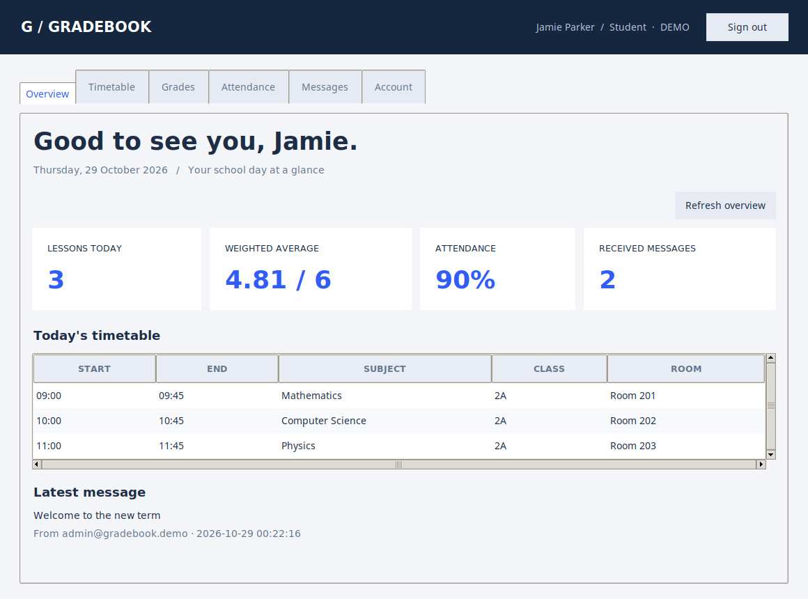
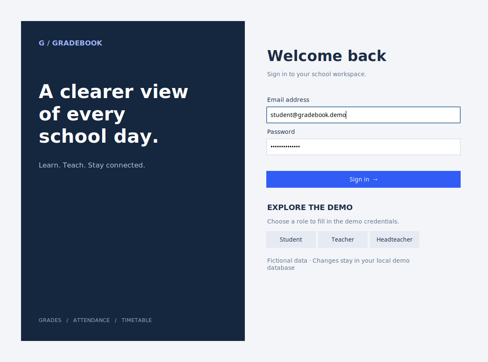

# Gradebook

**A clearer view of every school day.** A Python desktop application for students, teachers, and headteachers, with a shared timetable, weighted grades, attendance tracking, and private messaging.

Built with **Python · Tkinter / ttk · MySQL · SQLite · unittest**. The interface, sample data, code, and documentation are in English.



## Try it in one command

Requires **Python 3.11+** with Tkinter and a desktop session. The demo has no third-party Python dependencies and requires no database server.

```bash
python3 main.py
```

On Windows, use `py main.py`. On Debian/Ubuntu, install `python3-tk` if Tkinter is missing. macOS users should use a Python installation that includes Tk support.

Choose **Student**, **Teacher**, or **Headteacher** on the sign-in screen to fill in the demo credentials, then click **Sign in**.

| Role | Email | Password |
| --- | --- | --- |
| Student | `student@gradebook.demo` | `Portfolio2026!` |
| Teacher | `teacher@gradebook.demo` | `Portfolio2026!` |
| Headteacher | `admin@gradebook.demo` | `Portfolio2026!` |

All demo accounts and school records are fictional. Demo changes persist in `~/.gradebook/demo.sqlite3`. Use `python3 main.py --demo-path ./another-demo.sqlite3` for a fresh, separate dataset. Demo credentials apply only to seeded databases; password changes persist too.



## What you can do

| Capability | Student | Teacher | Headteacher |
| --- | --- | --- | --- |
| Timetable | Own class | Assigned lessons | All lessons |
| Grades | Own records and subject averages | Add/remove own grades for assigned subjects and classes | Manage all grades |
| Attendance | Own records | Record/update/remove for own lessons | Manage all attendance |
| Messaging | Inbox, sent messages, compose | Inbox, sent messages, compose | Inbox, sent messages, compose |
| Account | Change password | Change password | Change password |
| Administration | — | — | Create/deactivate users, reset passwords, add/remove lessons |

Grades range from **1 to 6**, with integer weights from **1 to 10**. The weighted average is `sum(grade × weight) / sum(weight)`. Attendance counts Present and Late as attended. Re-recording the same student, lesson, and date updates the existing entry. Timetable validation rejects overlapping teacher, class, or room bookings.

## A quick portfolio walkthrough

1. Sign in as a student. Explore the overview, subject averages, attendance, and inbox.
2. Sign out and choose Teacher. Add a Mathematics grade for Jamie Parker and send Jamie a message.
3. Sign in as the student again. Refresh the grades and inbox to see the changes.
4. Choose Headteacher. Open Administration to create an account or manage the timetable. Try adding an overlapping lesson to see validation in action.

## Run with MySQL

Use **MySQL 8.0.16+** in a local development environment. The MySQL backend uses the same application rules as the SQLite demo and never seeds demo accounts automatically.

```bash
python3 -m venv .venv
source .venv/bin/activate
# Windows PowerShell: .venv\Scripts\Activate.ps1
python -m pip install -r requirements.txt
```

Create a dedicated database and local database account using a MySQL administrator connection:

```sql
CREATE DATABASE gradebook CHARACTER SET utf8mb4 COLLATE utf8mb4_unicode_ci;
CREATE USER 'gradebook'@'localhost' IDENTIFIED BY 'choose-a-strong-local-password';
GRANT SELECT, INSERT, UPDATE, DELETE, CREATE, REFERENCES
    ON gradebook.* TO 'gradebook'@'localhost';
```

Set the connection variables in your shell. `.env.example` documents all settings; the app does not automatically load `.env` files.

```bash
export GRADEBOOK_DB_HOST=127.0.0.1
export GRADEBOOK_DB_PORT=3306
export GRADEBOOK_DB_NAME=gradebook
export GRADEBOOK_DB_USER=gradebook
read -rs -p 'MySQL password: ' GRADEBOOK_DB_PASSWORD
export GRADEBOOK_DB_PASSWORD

python main.py --backend mysql --init-db
python main.py --backend mysql --create-admin
python main.py --backend mysql
```

In PowerShell use `$env:GRADEBOOK_DB_PASSWORD = 'your-local-password'` and the same syntax for other variables. Administrator setup prompts for a password without echoing it. It works only before the first user exists. Create subsequent accounts through Administration.

After initialization, the runtime database account only needs SELECT, INSERT, UPDATE, and DELETE. Credentials are read from environment variables and are never stored in this repository.

**Upgrading the original project:** version 2 uses a new normalized schema. Create a separate, empty database. The legacy `Users`, `Lessons`, and related tables are not migrated automatically, and old password hashes are not imported. See [architecture and design decisions](docs/architecture.md).

## Development and checks

```bash
python3 -m unittest discover -s tests -v
python3 -m compileall -q gradebook main.py
```

Optional tooling:

```bash
python3 -m pip install -e '.[dev]'
ruff check .
ruff format --check .
# Linux GUI smoke check, with Xvfb installed:
xvfb-run -a python3 tests/gui_smoke.py
# Regenerate the README screenshots (requires Pillow):
xvfb-run -a -s '-screen 0 1160x860x24' python3 tests/gui_smoke.py --screenshots
```

GitHub Actions runs service tests and lint checks across Python versions, and a Linux GUI smoke check. Tests cover permission boundaries, namesake students, password changes, timetable conflicts, duplicate attendance, messaging privacy, and transaction rollback. A separate MySQL job exercises the service against a fresh MySQL 8 database.

## Project structure

```text
gradebook/
  __main__.py     CLI, configuration, and connection lifecycle
  database.py     DB-API adapter and transaction handling
  schema.sql      Shared relational schema
  security.py     Salted scrypt password hashing
  service.py      Authorization, validation, and school workflows
  demo.py         Fictional data for the SQLite demo
  ui.py           Desktop views and reusable form/table components
tests/            Service regression tests, MySQL integration, GUI smoke check
docs/             Screenshots and architecture notes
main.py           Convenient desktop entry point
```