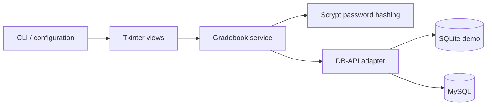
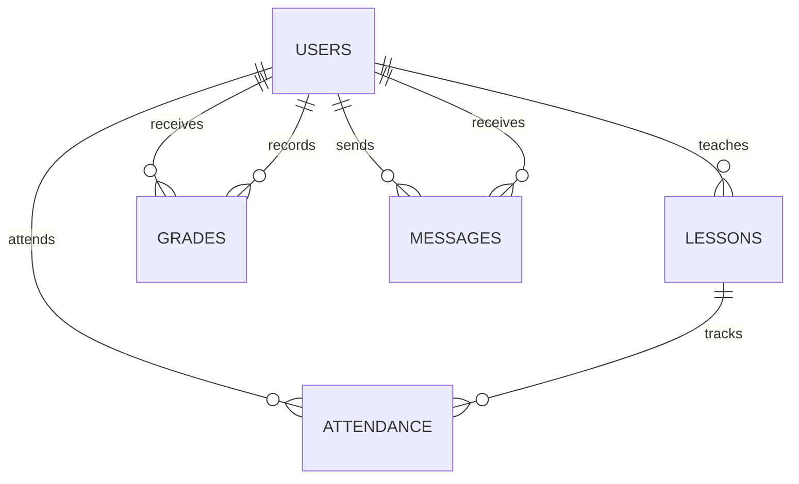

# Architecture and design decisions

## Separation of concerns

The desktop interface calls `Gradebook` service methods rather than executing SQL. The service checks the authenticated user for every operation, validates input, and delegates parameterized queries to the database adapter. The adapter converts parameter placeholders for MySQL and returns dictionary rows for both backends.

## Data model

Relationships use numeric user IDs, so students with identical names cannot share records accidentally. Teacher names are presentation data rather than foreign keys. Subjects and class names are free-text identifiers, trimmed and class-normalized by the service; a subject catalog is a possible future extension.

The schema enforces foreign keys, unique emails, grade/weight ranges, role/status values, and unique attendance per student, lesson, and date. Lesson times use zero-padded HH:MM strings and dates use ISO 8601 strings, keeping ordering consistent between backends. The service validates real calendar dates, weekday consistency, and overlapping time intervals.

## Authentication and authorization

Passwords use scrypt with a random 16-byte salt and constant-time digest comparison. No plaintext passwords are persisted or logged. Failed sign-in clears the existing session. Current account status is re-read before service operations, so deactivating an account invalidates its session on the next action.

Only a headteacher creates users or manages the timetable. Teachers write grades for students in assigned classes and subjects, remove their own grades, and manage attendance for their own lessons. Students read only their own records. The first administrator is created through an interactive CLI command on an empty database. Demo data creation uses the same service workflows.

These controls protect application workflows; a user with direct database credentials can bypass the desktop service. This is a local portfolio application, not a security boundary for an untrusted multi-user deployment.

## Transactions and record retention

Each service write runs in a transaction and rolls back on failure. Accounts are deactivated instead of deleted so grades, messages, and attendance remain intact. A lesson with attendance cannot be removed. Grade and attendance removal require confirmation in the interface. Password resets are available to headteachers; users can change their own passwords after confirming the current one.

## Portability and scope

The default SQLite demo is persistent and requires only Python with Tkinter. MySQL is an optional backend configured through environment variables. Importing the package does not connect to a database or open a window. Schema resources resolve relative to the package rather than the shell working directory.

The schema is version 2 and deliberately does not mutate the original version 1 database. Use a fresh database when upgrading. A future migration tool would need to map legacy name-based teacher references and reissue passwords.

The interface uses a shared ttk theme and resizable layouts with scrollable tables and forms. Its minimum window size is 1000 × 820 pixels. The overview is a snapshot; Refresh reloads it after changes elsewhere. The app has no background polling or multi-client conflict locking. Time-based records use local dates and times; school timezone management is outside the current scope.
